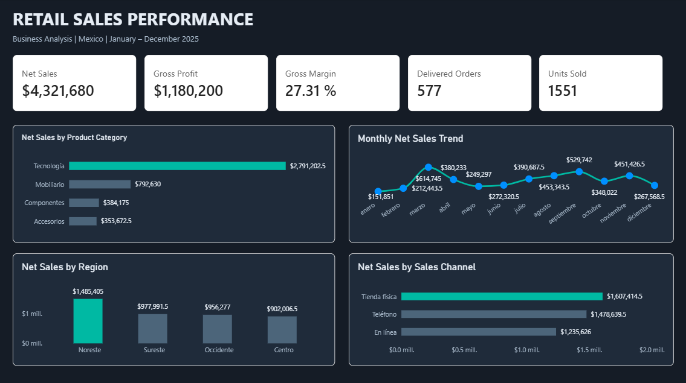
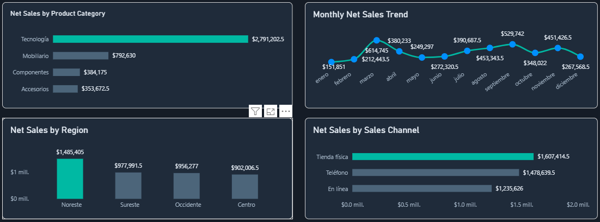

# Retail Sales Business Analysis

An end-to-end retail sales analysis project using **PostgreSQL, SQL, Python, and Power BI** to evaluate sales performance, profitability, regional results, sales channels, and data quality.

## Project Overview

This project analyzes retail sales transactions to transform raw business data into actionable insights. It combines SQL-based business analysis, Python data processing, and an interactive Power BI dashboard.

The analysis focuses on:
- Sales performance and profitability.
- Product category performance.
- Monthly sales trends.
- Regional sales performance.
- Sales channel performance.
- Data quality assessment and validation.

## Business KPIs

| KPI | Result |
|---|---:|
| Net Sales | $4,321,680 MXN |
| Gross Profit | $1,180,200 MXN |
| Gross Margin | 27.31% |
| Delivered Orders | 577 |
| Units Sold | 1,551 |

## Power BI Dashboard

The dashboard provides an executive overview of retail performance through five KPI cards and four analytical visualizations.



### Sales Analysis



### Key Performance Indicators


## Tools & Technologies

- **PostgreSQL:** Data storage, SQL queries, data quality checks, and business analysis.
- **SQL:** Aggregations, joins, filtering, analytical queries, and business metrics.
- **Python:** Data processing, analysis, and CSV output generation.
- **Power BI:** Interactive dashboard and business performance visualization.
- **GitHub:** Project versioning and documentation.

## Project Structure

```text
retail-sales-business-analysis/
│
├── documentation/
│   ├── business_findings.md
│   ├── retail_sales_dashboard.png
│   ├── retail_sales_charts.png
│   └── retail_sales_kpis.png
│
├── outputs/
│   └── Analytical CSV outputs
│
├── python/
│   └── Python scripts
│
├── sql/
│   └── SQL scripts
│
└── Retail_Sales_Business_Analysis.pbix
```

## Analytical Approach

1. **Database and data preparation:** PostgreSQL database setup and data staging.
2. **Data quality assessment:** Validation of records and identification of data anomalies.
3. **Business analysis:** SQL queries to calculate KPIs and evaluate sales performance.
4. **Python analysis:** Data processing and generation of analytical CSV outputs.
5. **Data visualization:** Power BI dashboard development to communicate business results.

## Key Business Results

- Generated **$4.32 million MXN** in net sales.
- Achieved **$1.18 million MXN** in gross profit.
- Recorded a **27.31% gross margin**.
- Analyzed **577 delivered orders** and **1,551 units sold**.
- Evaluated sales performance across product categories, regions, months, and sales channels.

## Project Purpose

This project demonstrates practical skills in data analysis, SQL querying, data quality, Python-based data processing, business intelligence, and data visualization.

**Author:** Alberto Sanchez  
**GitHub:** [albertosanchez-data](https://github.com/albertosanchez-data)  
**LinkedIn:** [Alberto Sanchez](https://www.linkedin.com/in/alberto-sanchez-data/)
